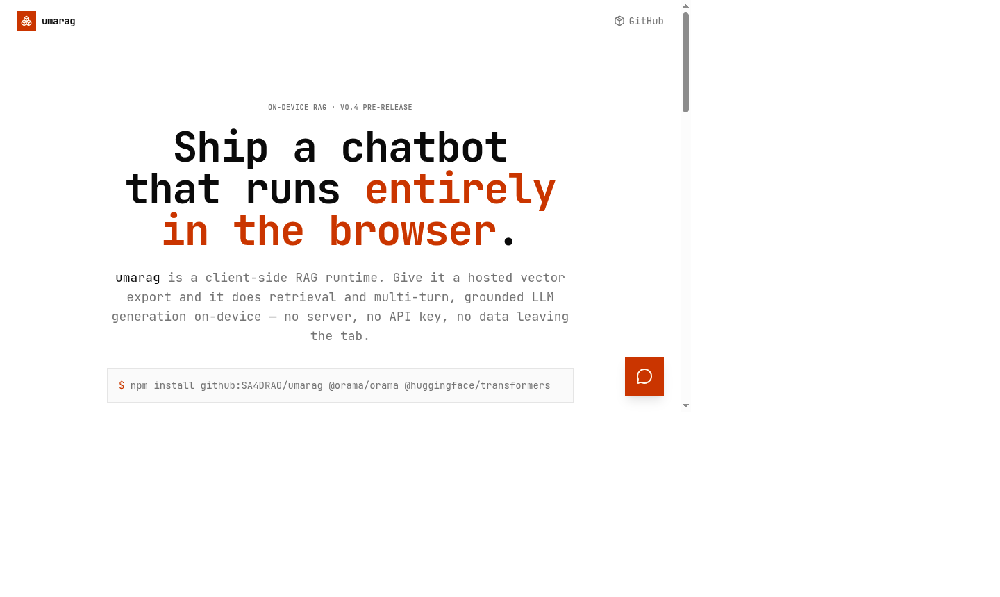
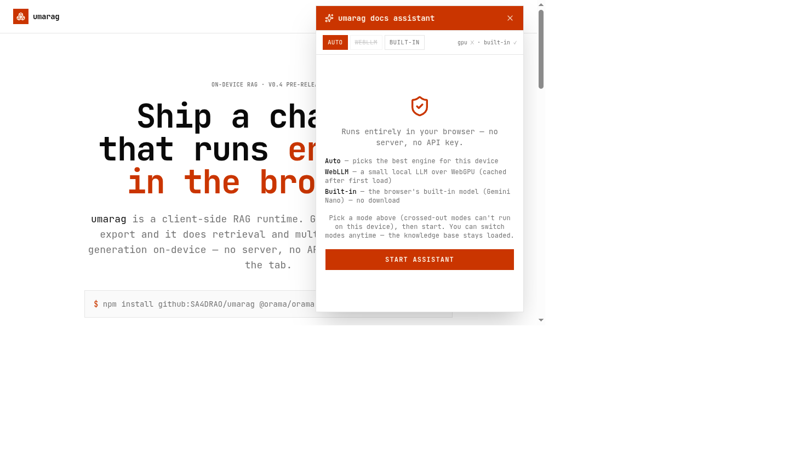

# umarag

**Client-side RAG chatbot runtime — on-device retrieval + LLM inference in the browser. Zero backend at query time.**

> 🚀 **[Live demo](https://umarag.vercel.app)** — the assistant in the bottom-right answers questions about this SDK, fully on-device.



You ship a static JSON vector export; `umarag` does the rest — embedding the query, vector search, prompt building, and streaming generation — all inside your user's tab. No inference server, no API keys, no per-token bill, no queries leaving the device.

```ts
import { EdgeChat } from '@sa4drao/umarag';

const chat = new EdgeChat({ knowledgeUrl: 'https://cdn.acme.com/kb-export.json' });
await chat.init();

const { sources, stream } = await chat.stream('How do I authenticate?');
for await (const delta of stream) appendToUI(delta);
```

## What this package is — and isn't

`umarag` is **consumption-only**. It does not chunk documents, generate embeddings, or run a vector database for you. You already have a pipeline that produces embeddings (or can build one in a few lines with Orama, below). `umarag` just needs a static JSON file matching the `KnowledgeExport` contract, hosted anywhere reachable by `fetch` — a CDN, a static asset, same-origin, doesn't matter.

You ship three things:

| | |
|---|---|
| **Guardrails** | A system prompt that pins the assistant to your knowledge base |
| **Model** | A WebLLM model over WebGPU, or the browser's built-in Prompt API (Gemini Nano) |
| **Embeddings** | One static `KnowledgeExport` JSON file, hydrated client-side |

## Install

```bash
npm install @sa4drao/umarag @orama/orama @huggingface/transformers
# optional, only if you want the WebLLM engine:
npm install @mlc-ai/web-llm
```

Not on the public registry yet? Install straight from GitHub instead — a `prepare` script builds `dist/` on install, so it resolves like the real package:

```bash
npm install github:SA4DRAO/umarag @orama/orama @huggingface/transformers
# npm 12+ blocks git installs by default — add: --allow-git=all
```

## 1. Produce a `KnowledgeExport` (your build pipeline, not this package)

```ts
import { create, insertMultiple, save } from '@orama/orama';
import { pipeline } from '@huggingface/transformers';
import fs from 'node:fs';

const embed = await pipeline('feature-extraction', 'Xenova/all-MiniLM-L6-v2');
const docs = [{ id: 'auth', text: 'To authenticate, pass the X-API-Key header...' }, /* ... */];

const chunks = [];
for (const d of docs) {
  const out = await embed(d.text, { pooling: 'mean', normalize: true });
  chunks.push({ id: d.id, text: d.text, embedding: Array.from(out.data) });
}

fs.writeFileSync('kb-export.json', JSON.stringify({
  schemaVersion: 1,
  embeddingModel: 'Xenova/all-MiniLM-L6-v2',
  embeddingDim: 384,
  systemPrompt: 'You are the support bot for Acme Corp.',
  chunks,
}));
// upload kb-export.json to your CDN of choice
```

`embeddingModel` must be the exact model id the client will load — `umarag` checks this at query time so a mismatched pipeline fails loudly instead of silently returning wrong similarity scores.

## 2. Use it client-side (any framework — plain ESM)

```ts
import { EdgeChat } from '@sa4drao/umarag';

const chat = new EdgeChat({ knowledgeUrl: 'https://cdn.acme.com/kb-export.json' });
await chat.init();

const { sources, stream } = await chat.stream('How do I authenticate?');
for await (const delta of stream) {
  appendToUI(delta);
}
```

Or non-streaming:

```ts
const { answer, sources } = await chat.ask('How do I authenticate?');
```

### Conversational memory

Both `ask()` and `stream()` take prior turns as an optional second argument (oldest first, without the current query) — that's the assistant's memory. Keep your own turn list and pass it back each time; the SDK includes the most recent turns in the prompt, bounded so small on-device context windows don't overflow:

```ts
import type { ChatMessage } from '@sa4drao/umarag';

const turns: ChatMessage[] = [];
const { answer } = await chat.ask('What about SSO?', turns);
turns.push({ role: 'user', content: 'What about SSO?' }, { role: 'assistant', content: answer });
```

## Engine selection & compatibility

`engine: 'auto'` (default) prefers WebLLM when you configured `webllmModel` or `webllmAppConfig` — you picked that model deliberately — and otherwise prefers the browser's built-in Prompt API (`window.LanguageModel`, on-device Gemini Nano, zero download). Either way it falls back to the other engine when the preferred one can't run. Force one explicitly with `engine: 'webllm'` or `engine: 'prompt-api'`.

Check what the current device can run — without loading any model:

```ts
import { checkCompatibility } from '@sa4drao/umarag';

const compat = await checkCompatibility();
// {
//   webllm:    { supported: boolean, reason?: string },  // WebGPU adapter granted?
//   promptApi: { supported: boolean, reason?: string },  // window.LanguageModel usable?
//   shaderF16: boolean,  // pick a q4f16 model build when true, q4f32 otherwise
// }
```

Use it to drive a backend picker UI, choose the right model quantization, or show your own unsupported-device message up front.



Switch engines on a live instance — the knowledge base and embedder stay loaded:

```ts
const active = await chat.switchEngine('prompt-api'); // or 'webllm' / 'auto'; returns the engine now active
```

The new engine is initialized before the old one is released, so a failed switch keeps the current engine working.

If no engine is available (no WebGPU, no Prompt API), `init()`/`ask()`/`stream()` throw `EdgeChatUnsupportedError` naming both reasons — there is no CPU fallback by design; on-CPU inference for a 1B+ model in-browser is too slow to be a usable product. Catch this and show your own fallback UX (e.g. a link to search docs instead).

## Config

```ts
interface EdgeChatConfig {
  knowledgeUrl: string;
  systemPrompt?: string;      // overrides the export's baked-in systemPrompt
  topK?: number;               // chunks retrieved per query, default 4
  minScore?: number;           // min cosine similarity to retrieve, default 0 (top-K only)
  engine?: 'auto' | 'webllm' | 'prompt-api'; // default 'auto'
  webllmModel?: string;        // default 'Llama-3.2-3B-Instruct-q4f16_1-MLC'
  webllmAppConfig?: WebLLMAppConfig; // custom model registry — serve weights from your own origin
  onProgress?: (report: { text: string; progress: number }) => void; // load phases + WebLLM download progress
}
```

## Lifecycle

`init()` is idempotent while in flight and after success; a **failed** `init()` is not cached, so calling it again retries the whole pipeline. `onProgress` reports coarse phases ("Loading knowledge base…", "Loading embedding model…") plus WebLLM's granular download/compile progress. Call `dispose()` when you're done (e.g. on SPA unmount) to release the LLM engine's GPU memory, the embedder, and the index — the instance can be `init()`ed again afterwards.

### Serving model weights from your own origin

Pass `webllmAppConfig` to point WebLLM at self-hosted weights instead of HuggingFace
(the model URL must contain `/resolve/<rev>/` and end with `/`, mirroring HF layout):

```ts
webllmModel: "gemma-2-2b-it-q4f16_1-MLC",
webllmAppConfig: {
  model_list: [{
    model: `${location.origin}/models/gemma-2-2b-it-q4f16_1-MLC/resolve/main/`,
    model_id: "gemma-2-2b-it-q4f16_1-MLC",
    model_lib: `${location.origin}/models/gemma-2-2b-it-q4f16_1_cs1k-webgpu.wasm`,
  }],
},
```

## Scale note

Retrieval is exact/brute-force vector search (via Orama) — fast at hundreds to low thousands of chunks. If your knowledge base is much larger, pre-filter/shard your export (e.g. one export per product area) rather than shipping the whole thing to the browser.

## Development demo

[`examples/react-demo`](examples/react-demo) is a Vite + React marketing page with an embedded docs assistant that dogfoods the SDK: self-hosted Gemma 2 2B over WebGPU, live engine/model switching, streaming answers with source citations. See its [README](examples/react-demo/README.md) to run it locally.

```bash
npm install          # repo root — builds the SDK (prepare script)
npm test             # 19 unit tests
npm run build:demo   # build SDK + demo → examples/react-demo/dist
```

## Status

Pre-release (v0.4). The API surface is stable for evaluation; the `KnowledgeExport` schema is versioned (`schemaVersion: 1`) and mismatches fail loudly. Publishing to npm as `@sa4drao/umarag` is the next step — until then, install from GitHub as shown above.

## License

MIT
